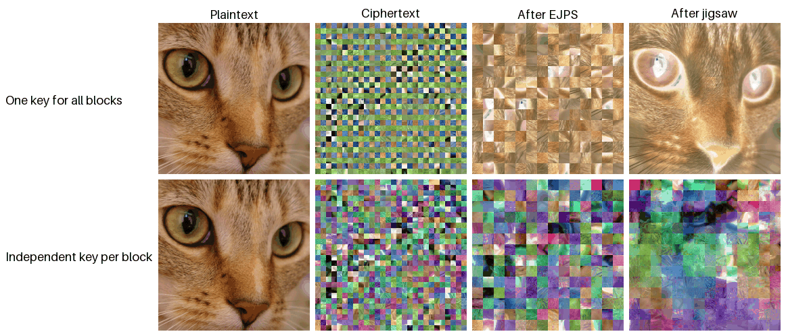

# EJPS_reimplemented

A ciphertext-only attack on block-wise EtC (encryption-then-compression) images:
extended jigsaw puzzle solver (EJPS) sub-block restoration [1], followed by a
block jigsaw solver ported from gaps [2]. CPU only.



## Project structure

```
run_attack.py              command-line entry point
ejps/
  pipeline.py              AttackConfig, attack_image / attack_frames, evaluate
  geometry.py              block <-> image conversion, transform groups, key groups, solver registry
  restore/
    edge.py                EJPS solver "edge_ref"
    layer_greedy.py        EJPS solver "layer_greedy"
    select.py              automatic candidate selection
  jigsaw/                  block jigsaw (port of gaps): domain.py, fitness.py, ga.py
  encrypt.py               test encryptor for --simulate (not a secure cipher)
  metrics.py               PSNR / SSIM, restoration and jigsaw accuracy
  cli.py                   argument parsing and output writing for run_attack.py
examples/chelsea_224.png   example plaintext
docs/demo.png              figure above (tools/make_demo_figure.py)
tests/                     pytest suite and golden fixtures
tools/                     fixture and figure generators
```

## Installation

Python >= 3.10. Dependencies: `numpy`, `scipy`, `pillow`
(tested with numpy 2.2 / 2.4, scipy 1.15, pillow 12).

```bash
pip install -e .            # package + dependencies
pip install -e ".[dev]"     # + pytest, ruff
```

## Usage

**1. Simulate: encrypt a plaintext, then attack it**

```bash
python run_attack.py --simulate examples/chelsea_224.png --key-groups common --scramble
python run_attack.py --simulate examples/chelsea_224.png --key-groups independent --scramble
```

**2. Attack an existing cipher image**

```bash
python run_attack.py --cipher cipher.png --jigsaw
python run_attack.py --cipher cipher.png --jigsaw --plain plain.png --sigma sigma.npy   # with scoring
```

**3. Batch**: pass a directory to `--simulate` / `--cipher`; each image gets its own output folder.

**4. Solver choice**

```bash
python run_attack.py --simulate examples/chelsea_224.png --scramble --solver layer_greedy \
    --solver-option fix_fourth_flip=true --solver-option one_plane_per_sub_block=true
```

Main options: `--solver {edge_ref,layer_greedy}`, `--key-groups {common,independent,per_position}`,
`--block-size` (16), `--sub-block-size` (8), `--jigsaw / --no-jigsaw`, `--population`,
`--generations`, `--seed`, `--top-k`, `--out` (`./outputs`). Full list: `python run_attack.py --help`.

Outputs (PNG): `cipher`, `restored` (after EJPS), `reconstruction` (after the jigsaw),
`candidate_<k>`, and `*_upright` display copies when the plaintext is known.

**5. Python API**

```python
import ejps

cipher, sigma = ejps.encrypt_image(plain, "common", seed=0, scramble=True)
cfg = ejps.AttackConfig(key_groups="common", jigsaw=True)
result = ejps.attack_image(cipher, cfg)  # result.restored, result.reconstruction
scores = ejps.evaluate(result, plain, cfg, sigma)
```

## Main functions

| function | purpose |
|---|---|
| `attack_image(cipher, cfg)` | full attack on one image: EJPS -> selection -> jigsaw |
| `attack_frames(frames, cfg)` | the same on a frame stack `(T, H, W, 3)` |
| `AttackConfig` | attack settings (solver, key groups, block sizes, jigsaw on/off, seed) |
| `evaluate(result, plain, cfg, sigma)` | scores against the plaintext after residual alignment |
| `display_upright(img, plain)` | rotates a result upright for display (uses the plaintext) |
| `EJPS_SOLVERS.build(name)` | creates an EJPS solver; `.solve(blocks, sub_block_size=8)` returns candidates |
| `rank_candidates` / `select_best` | ranks EJPS candidates by cross-channel correlation |
| `solve_jigsaw(image, piece_size)` | reassembles scrambled blocks (gaps genetic algorithm) |
| `encrypt_image` / `encrypt_frames` | test encryptor; returns cipher and block permutation `sigma` |
| `decrypt_with_key`, `generate_key` | inverse of the test encryptor, key generation |
| `image_to_blocks` / `blocks_to_image` | split an image into blocks and back |
| `KeyGroups` | which blocks share one key: `common`, `independent`, `per_position` |
| `psnr`, `ssim` | image quality metrics |

## Pipeline

1. **Key groups**: blocks sharing one key are solved together.
2. **EJPS**: undoes sub-block shuffling, rotation / flip, negative-positive
   transformation and channel shuffling from edge continuity.
3. **Candidate selection**: keeps the candidate with the strongest cross-channel correlation.
4. **Block jigsaw**: reassembles scrambled blocks.

A global rotation / flip, the channel order and channel inversion cannot be
recovered, so results may appear rotated or with altered colours.

## License

MIT. `ejps/jigsaw/` is ported from gaps (MIT, see `THIRD_PARTY_LICENSE_gaps.txt`).
`examples/chelsea_224.png` is a crop of the CC0 scikit-image "chelsea" image.

## References

[1] T. Chuman, K. Kurihara, and H. Kiya, "On the security of block scrambling-based
EtC systems against extended jigsaw puzzle solver attacks," *IEICE Transactions on
Information and Systems*, vol. E101.D, no. 1, pp. 37–44, 2018.

[2] Nemanja Milićević, *gaps*, https://github.com/nemanja-m/gaps
